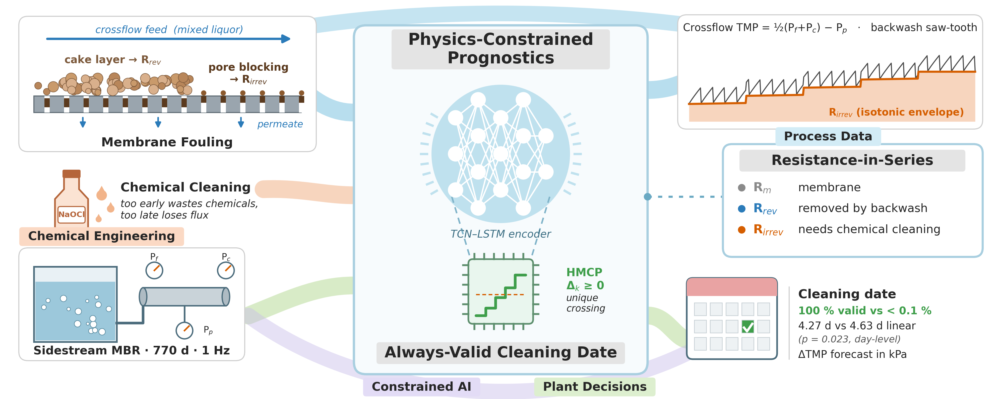

# HMCP: an always-valid chemical-cleaning date for membrane bioreactors

[](https://colab.research.google.com/github/gulzara3/hmcp-mbr-cleaning-date/blob/main/notebooks/HMCP_cleaning_date_forecast.ipynb)
[](https://www.python.org/)
[](https://pytorch.org/)
[](LICENSE)
[](https://doi.org/10.5281/zenodo.821585)
[](https://github.com/gulzara3/hmcp-mbr-cleaning-date/actions/workflows/ci.yml)

Code accompanying the manuscript

> **Physics-constrained deep learning ensures a valid chemical-cleaning date for membrane bioreactors from routine pressure data**
> Gulzar Alam, Ihsanullah, *et al.* (manuscript under review)



## Why this exists

Chemical cleaning-in-place (CIP) of membrane bioreactors is usually triggered by a fixed interval or a transmembrane
pressure (TMP) threshold. Neither tells the operator *how many days remain*, and neither separates removable cake
from irreversible fouling. This repository turns 1 Hz plant pressure data into a **forecast of the next irreversible
fouling step**. The forecast is built so that a single, valid cleaning date always exists.

The approach has three parts:

1. **Physics-correct monitoring.** The crossflow TMP is reconstructed from three transducers as
   ½(P<sub>feed</sub> + P<sub>conc</sub>) − P<sub>perm</sub>. It is converted to viscosity-corrected Darcy resistance and
   split into reversible and irreversible parts (resistance-in-series) with a daily-quantile isotonic envelope.
2. **Hard-monotone cumulative parameterisation (HMCP).** A TCN–LSTM encoder predicts *non-negative daily increments*
   of irreversible resistance as a correction to linear and power-law fouling extrapolations. Every forecast trajectory
   is therefore non-decreasing and crosses the decision threshold exactly once.
3. **Validation guard.** A learned correction to the physics seed is deployed only when held-out validation shows that
   it helps.

## Key results (five forward-chaining folds, 5,315 uncensored windows)

| Method | Valid cleaning date | MAE (d) | 95 % CI (d) | α–20 accuracy |
|---|---:|---:|---|---:|
| **HMCP (deployed)** | **100 %** | **4.27** | 3.33–5.25 | 0.297 |
| Physics seed (untrained HMCP) | 100 % | 4.49 | 3.50–5.50 | 0.307 |
| Linear extrapolation (7 d) | 100 % | 4.63 | 3.68–5.60 | 0.271 |
| Power-law extrapolation | 100 % | 4.69 | 3.73–5.71 | 0.253 |
| Gradient-boosted RUL regressor | 100 % | 6.00 | 4.99–7.02 | 0.253 |
| Persistence | 100 % | 6.55 | 5.49–7.62 | 0.235 |
| Soft-penalty network | < 0.1 % | – | – | – |
| Unconstrained network | < 0.1 % | – | – | – |

Confidence intervals come from a day-block bootstrap over 56 independent days, with Holm correction. Across 43,226
held-out windows, HMCP returned a valid date for every one. Networks with the same encoder but a soft penalty or no
constraint returned one for fewer than 0.1 %. Without the validation guard, the error rose to 5.39 d (p < 0.001).

## Repository structure

```
hmcp-mbr-cleaning-date/
├── notebooks/
│   └── HMCP_cleaning_date_forecast.ipynb   # full pipeline (Colab-ready, resumable)
├── scripts/
│   ├── hmcp_cleaning_date_forecast.py      # the same pipeline as a plain Python script
│   └── download_data.py                    # verified download of the Zenodo dataset
├── docs/
│   ├── METHOD.md                           # method summary with equations
│   ├── REPRODUCIBILITY.md                  # hardware, runtime, caching, outputs
│   └── figures/                            # framework figure and graphical abstract
├── data/README.md                          # dataset description (raw data are not committed)
├── results/README.md                       # what the pipeline writes here
├── requirements.txt / environment.yml
├── CITATION.cff
└── LICENSE
```

## Quick start

### Option A: Google Colab (recommended, GPU)

1. Click **Open in Colab** above, then choose *Runtime → Change runtime type → GPU* (an L4 or A100 is ideal).
2. Choose *Runtime → Run all*. The notebook mounts Google Drive, downloads and verifies the dataset, trains, and writes
   all tables and figures. Checkpoints are stored on Drive, so an interrupted run resumes where it stopped.

### Option B: local machine

```bash
git clone https://github.com/gulzara3/hmcp-mbr-cleaning-date.git
cd hmcp-mbr-cleaning-date
python -m venv .venv && source .venv/bin/activate      # Windows: .venv\Scripts\activate
pip install -r requirements.txt                        # install the CUDA build of PyTorch first if you have a GPU
python scripts/download_data.py                        # about 680 MB, verified, into results/data
jupyter lab notebooks/HMCP_cleaning_date_forecast.ipynb
```

You can also run the whole pipeline as a script: `python scripts/hmcp_cleaning_date_forecast.py`.
Two environment variables change where files go:
- `HMCP_OUT` sets the local output folder.
- `HMCP_DRIVE_DIR` sets the Google Drive folder used on Colab.

## Data

The dataset is the Ghent University BIOMATH lab-scale sidestream crossflow MBR record:
- 770 days at 1 Hz, in four operating periods;
- feed, concentrate and permeate pressures, flux, temperature, dissolved oxygen, pH, level and phase signals.

It is openly available at <https://doi.org/10.5281/zenodo.821585> (Naessens *et al.*, 2017). The raw files are not
redistributed here. See [`data/README.md`](data/README.md).

## Outputs

A complete run writes the following under `results/`:
- per-fold model checkpoints;
- the validity and accuracy tables (CSV and Word);
- the day-level significance tests;
- the process-engineering layer:
  - resistance-in-series budget;
  - hydraulic reversibility;
  - irreversible fouling rate in kPa d⁻¹;
  - 14-day TMP-rise forecast in kPa;
- 600-dpi publication figures (PNG, PDF and SVG) in `results/figures_final/`.

See [`results/README.md`](results/README.md).

## Citation

If you use this code, please cite the paper (citation details will be added on publication) and the dataset:

```bibtex
@misc{naessens2017mbr,
  author    = {Naessens, Wouter and Maere, Thomas and Van Hauwermeiren, Daan and Nopens, Ingmar},
  title     = {Lab-scale membrane bioreactor (MBR) high-frequency online data},
  publisher = {Zenodo},
  year      = {2017},
  doi       = {10.5281/zenodo.821585}
}
```

GitHub's *Cite this repository* button uses [`CITATION.cff`](CITATION.cff).

## License

The code is released under the [MIT License](LICENSE). The dataset is distributed by its authors under the terms
stated on its Zenodo record.

## Acknowledgements

We thank the BIOMATH research group at Ghent University for making the high-frequency MBR dataset openly available.
