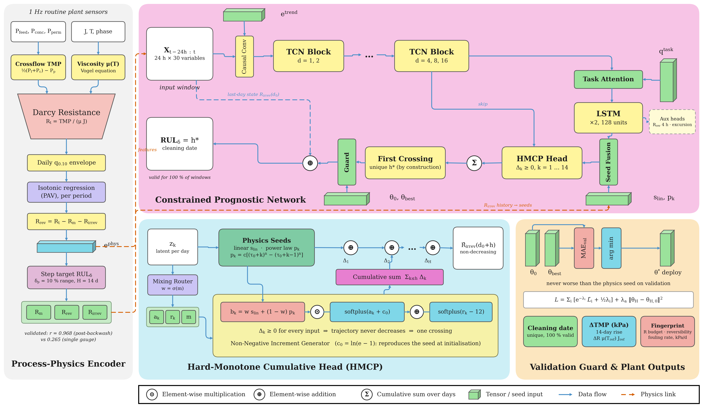

# Method summary

This page summarises the pipeline implemented in
[`notebooks/HMCP_cleaning_date_forecast.ipynb`](../notebooks/HMCP_cleaning_date_forecast.ipynb).
Section numbers refer to the notebook.

## 1. From pressures to resistance (notebook §3.1)

In a crossflow module the feed-side pressure falls along the channel. The driving pressure is therefore the mean of
the inlet and outlet pressures minus the permeate pressure:

$$\mathrm{TMP} = \tfrac{1}{2}\,(P_\mathrm{feed} + P_\mathrm{conc}) - P_\mathrm{perm}$$

TMP is computed at 1 Hz on filtration samples only and averaged over 5-min blocks. Permeate viscosity follows the
Vogel equation, $\mu(T) = A_v\,10^{B/(T-C)}$, with $A_v = 2.414\times10^{-5}$ Pa s, $B = 247.8$ K and $C = 140$ K.
Darcy's law then gives the total resistance:

$$R_t = \frac{\mathrm{TMP}}{\mu(T)\,J}$$

## 2. Reversible and irreversible resistance (notebook §3.2)

The total resistance is split by the resistance-in-series model as $R_t = R_m + R_\mathrm{rev} + R_\mathrm{irrev}$:

- The lower envelope is the daily 10th percentile of $R_t$.
- $R_m$ is the 5th percentile of that envelope in each period.
- $R_\mathrm{irrev}$ is the isotonic (non-decreasing) regression of the envelope excess, solved by pool-adjacent-violators
  separately in each operating period.
- $R_\mathrm{rev} = \max\{0,\,R_t - R_m - R_\mathrm{irrev}\}$.

As a check, the decomposition is compared with an independent post-backwash envelope and with a single-gauge
decomposition.

## 3. Prognostic target (notebook §3.4)

The target is the number of days until irreversible resistance rises by one degradation step $\delta_p$, equal to 10 % of
the period range:

$$\mathrm{RUL}_\delta(d_0) = \min\{k \ge 1 : R_\mathrm{irrev}(d_0+k) - R_\mathrm{irrev}(d_0) \ge \delta_p\}$$

Labels are right-censored at $H = 14$ d.

## 4. Hard-monotone cumulative parameterisation (notebook §4)

**Encoder.** A 24-h window of 30 variables is encoded by a dilated causal TCN, a two-layer LSTM and task-specific
attention.

**Seeds.** The head corrects two classical extrapolations computed from the trailing seven days:
- a linear slope $s_\mathrm{lin} \ge 0$;
- power-law increments $p_k \ge 0$.

**Increments.** The head predicts daily increments

$$\Delta_k = \mathrm{softplus}(a_k + c_0)\,[\,w\,s_\mathrm{lin} + (1-w)\,p_k\,] + \mathrm{softplus}(r_k - 12),\qquad c_0 = \ln(e-1)$$

and the trajectory is $\hat R_\mathrm{irrev}(d_0+h) = R_\mathrm{irrev}(d_0) + \sum_{k\le h}\Delta_k$.

**Why the date always exists.** Since $\Delta_k \ge 0$ for any network output, every trajectory is non-decreasing. It
therefore crosses the step level at most once, so the forecast cleaning date is unique by construction.

**Initialisation.** The head is zero-initialised, so the untrained model reproduces the physics seed exactly.

## 5. Training and validation guard (notebook §5–6)

**Loss.** The loss combines three parts:
- a differentiable expected first-crossing time;
- a hinge term for censored windows;
- auxiliary heads (reversible resistance 4 h ahead, and a focal-loss excursion classifier).

These are weighted by homoscedastic uncertainty, and an L2 anchor ties the head to its initialisation.

**Guard.** The guard deploys the trained head only if it beats the untrained seed on validation data:
$\theta^* = \arg\min_{\theta\in\{\theta_0,\theta_\mathrm{best}\}} \mathrm{MAE}_\mathrm{val}(\theta)$.

**Evaluation.** Models are evaluated with five forward-chaining folds. Seven methods are compared on identical windows,
with day-level block-bootstrap inference and Holm correction (notebook §6.4).

## 6. Process-engineering layer (notebook §8)

Resistance changes are converted back to pressure with $\Delta\mathrm{TMP} = \Delta R\,\mu(T_\mathrm{ref})\,J_\mathrm{ref}$
at each period's reference conditions. The notebook reports per period:
- the resistance-in-series budget;
- hydraulic reversibility;
- backwash frequency;
- permeability (LMH bar⁻¹);
- the irreversible fouling rate (kPa d⁻¹);
- the TMP size of one degradation step.

It also scores the 14-day irreversible TMP-rise forecast in kPa. Fouling rates are computed on *period-pure* days only,
i.e. days whose samples lie inside one operating period.
